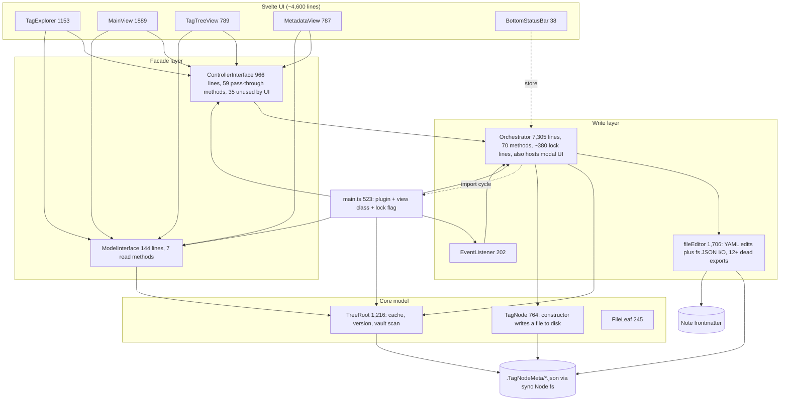
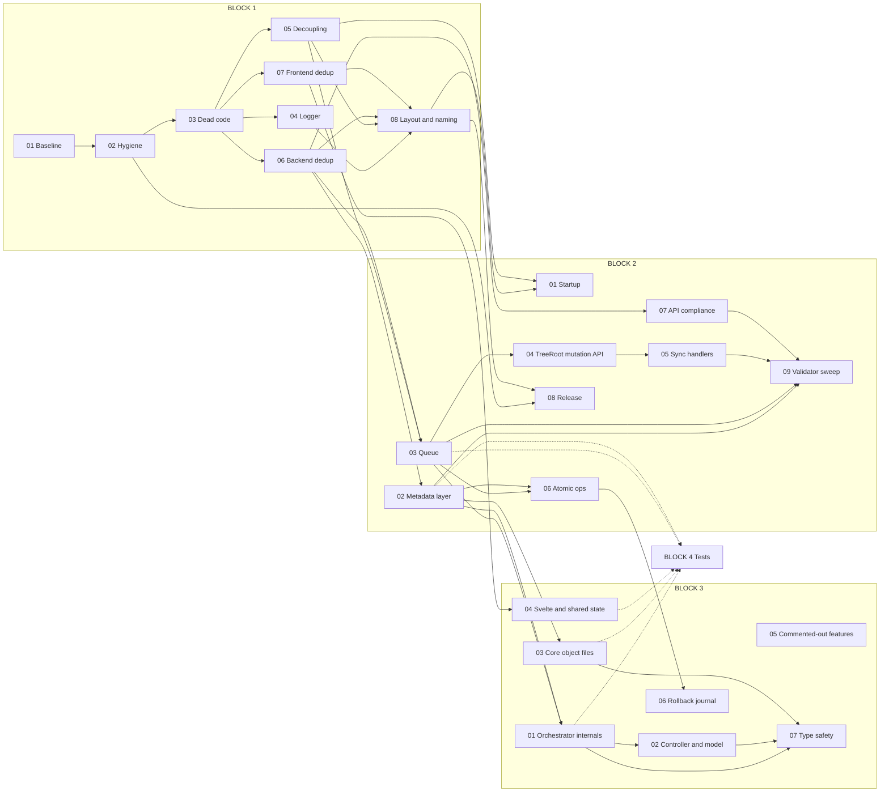

# Tag Folder Explorer: architecture and roadmap

This is the master document. Block folders hold the task-level detail.

## 1. Vision (from the project owner)

The plugin builds and maintains a virtual file structure of all vault files, based on their tags.

- The structure is built when the plugin loads. All other actions reference and update it.
- All UI data comes from this virtual structure. Several tabs on different folders are all views of the one central object.
- The **orchestrator** is the only thing that updates the structure. It decides which function of which object to call and what happens after.
- The **controller interface** is the safe set of write functions the UI may call (MVC controller). The orchestrator is not fully exposed to the UI.
- The **model interface** is the safe set of read functions that populate the UI.
- `FileLeaf`, `TagNode` and `TreeRoot` hold the functions for their own objects.
- Folder metadata lives hidden under `.TagNodeMeta` on purpose. It may not work with Obsidian Sync, and that is accepted. Its structure is not to change.
- The owner explicitly allows deviating from this structure when it causes problems, as long as every deviation is highlighted (see section 6).
- Final goal: a system that can roll back from crashes and interruptions without corrupting data or state.

## 2. Decisions log (in order)

1. Delivery is incremental. The owner validates each block before the next starts.
2. Block 1: low risk, no behavior change, clean base.
3. Block 2: reliability and compliance. The owner rates these as most important.
4. Block 3: identify other files and places to refactor, like `orchestrator.ts`.
5. Block 4: tests are a final step chosen later. They must cover the Obsidian API layer and individual functions.
6. `.TagNodeMeta` contents are throwaway test data. No migration is needed.
7. Operations arriving while another runs should be **queued**. Today they are rejected. Queuing gives a smoother UI.
8. Strict TypeScript flags: fix only when the change is small. If it causes deeper changes, put it in a backlog.
9. Metadata folder name: keep `.TagNodeMeta`, and keep its structure.
10. Rollback register: decide later. Block 2 ships reorder-and-compensate with journal-ready design.
11. Commented-out feature code stays as is. Review it as a separate task (Block 3, task 05).
12. Defaults still open and changeable: boundary matching for excluded folders (Block 2 task 07), and moving the six modal triggers to `ui/` (Block 3 task 02).
13. Multiple explorer tabs are intended, so `getLeaf(true)` behavior stays.
14. The controller stays as the only UI write entry. Its 35 UI-unused methods are intended API and stay.
15. Every finding of the Obsidian validator bot is tracked in `00b_validator_findings_traceability.md`. A finding is fixed only when it is gone under the scanner-equivalent lint (Block 2 task 09). Block 2 closes everything except the typing group.
16. Typing findings (`no-unsafe-*`, `no-explicit-any`, about 1,300 on the published version) get their own task, Block 3 task 07, after the orchestrator split so each module is typed once.

## 3. Current structure



### Data flow

- Write path: Svelte -> `ControllerInterface` -> `Orchestrator` -> `fileEditor` / `TreeRoot` / `TagNode` / `FileLeaf` -> `plugin.broadcastTreeUpdate()`.
- Read path: Svelte -> `ModelInterface` -> `TreeRoot` (`getSortedTree`, `getNode`, `getFile`).
- Startup: `onLayoutReady` -> `TreeRoot.create` (scans vault, `recomputeTree`) -> `new Orchestrator` -> `new ControllerInterface` -> `new ModelInterface` -> `new EventListener(...).registerListeners()`.
- Versioning: `treeVersion` bumps in `recomputeTree` and in `invalidateCache()` (this was corrected during analysis: `invalidateCache()` does bump it). `broadcastTreeUpdate` serializes the full sorted tree and pushes it to views where `containerEl.isShown()`. Hidden views catch up on `active-leaf-change` by comparing versions.
- Three-phase pattern in every write: physical edit, then virtual (in-memory) edit, then broadcast.

### State storage

- File-level state (tags, pin, legend, bookmark) lives in note YAML, edited via `fileManager.processFrontMatter`. Keys look like `🏷-Legend-<color>` with values prefixed `🏠/<tagPath>` and `🔒/ <tagPath>` (note the space after the slash). **This is persistent user data. Do not change the format.**
- Folder-level state (description, legend, pin, bookmark, Raindrop link, and existence of empty folders) lives in `<vault>/.TagNodeMeta/<sha256(tagPath)>.json`. It uses synchronous Node `fs` from three files.
- Empty folders exist only because their JSON file exists. Storage format therefore decides how folders persist.

### Orchestrator composition (7,305 lines, 70 methods)

| Family | Approx lines | Touches |
|---|---|---|
| Flag and infra: `getInconsistencyFlag`, `setInconsistencyFlag`, `writeToRollbackRegister` (never called) | 39-93 | flag |
| External sync: `syncExternalFileCreation/Rename/Modify/Delete` | 94-401 | tree; reads flag, never sets it |
| File ops: `createFileInTagFolder` 403, `renameFile` 629, `removeFileFromFolder` 944, `hardDeleteFile` 1282, `moveFileToFolder` 1724, `copyFileToFolder` 1893, `updateFileDescription` 2189, `addFileToTagpath` 6627 | | YAML, folder JSON "modified", tree, flag |
| Folder ops: `createFolderInFolder` 530, `renameFolder` 712, `removeFolderFromFolder` 1080, `moveFolderToFolder` 1384, `duplicateFolder` 2263, `recreateFolder` 2600 | | YAML for files under folder, heavy JSON, tree, flag |
| Folder metadata edits: description 2005, Raindrop link 2064, legend 2127 | | JSON |
| Clipboard: copy 2961, cut 3018, paste 3075 | | delegates to move/copy/recreate with `owner=false` |
| File legend/pin/bookmark add/remove/cycle/lock | 3254-4088, 4089-4580, 5154-5418 | YAML |
| Folder pin/bookmark/legend add/remove/cycle/lock | 4581-5153, 5419-5674, 5675-6184 | JSON |
| Status readers (legend, pinned, bookmark; file and folder) | 6185-6626 | YAML / JSON |
| Modal triggers: rename 6727, new 6806, delete 6918, move 6993, copy 7082, legend 7173 | | `InputModal`, `ConfirmationModal`, `SingleSelectModal` |
| Misc: `toHashtagSafe` 6889, `toSafeFileName` 6903, `revealFileInNavigation` 7254 | | |

About 60% of the file is the legend/pin/bookmark families, which differ mostly by key name and by YAML-vs-JSON backing.

Every write method has the same shape: check `(!flag && owner) || !owner`, set flag, physical edits, virtual edits, `invalidateCache()`, `broadcastTreeUpdate()`, clear flag. `owner=false` lets composite operations reuse primitives without re-locking.

### File sizes and roles

| File | Lines | Role |
|---|---|---|
| `main.ts` | 523 | Plugin and `TagExplorerView`, owns tree, controller, model, flag, view registry |
| `orchestrator.ts` | 7305 | Write coordinator |
| `controllerInterface.ts` | 966 | 1:1 proxy of orchestrator methods |
| `modelInterface.ts` | 144 | Read facade over `TreeRoot` |
| `eventlistener.ts` | 202 | Vault create/rename/modify/delete listeners for `.md` files |
| `TreeRoot.ts` | 1216 | Root, serialized-tree cache, version, excluded folders, `.TagNodeMeta` scan |
| `TagNode.ts` | 764 | One tag folder: children, files, metadata JSON |
| `FileLeaf.ts` | 245 | One note: tags, metadata, preview, ctime/mtime |
| `fileEditor.ts` | 1706 | ~40 functions: YAML edits plus JSON metadata I/O |
| `interfaces.ts` | 805 | Types |
| `modals.ts` | 242 | Three modal classes |
| `settings.ts` | 124 | Settings and tab |
| `store.ts` | 3 | `inconsistencyFlag` writable |
| `windows.ts` | 107 | Opens files, explorer tabs, Raindrop webviewer |
| `sampleRollbackRegister.*` | 271 / 348 | Design sketches, unused |
| `mainold.ts.txt` | 180 | Dead sample template |

## 4. Findings

### A. Correctness and data safety

1. The lock is a boolean try-lock. A second action fails silently, external vault events during an operation are dropped (tree drifts), and one missed reset among ~380 sites sticks the flag and disables all sync until reload. No `finally` is used.
2. Compound operations are not atomic. `moveFileToFolder` removes the source tag and strips legend and pin data before adding the destination tag. If the add fails, the file ends with no tag. `hardDeleteFile` trashes the file before virtual edits that can fail. No rollback exists.
3. `writeToRollbackRegister` is never called. Its path is hardcoded as `.obsidian/plugins/Tag-Folder-Explorer/...` (plugin id is lowercase, ignores `configDir`). Sample ndjson is multi-line JSON, while the writer writes one line per record. The sample `timestamp` is in seconds, code elsewhere uses ISO strings.
4. Startup race. `metadataCache.resolvedLinks` is always truthy, so the wait branch never runs. `initializeTree` can run twice and is not guarded. Views opened early (including restored tabs) get a null model, and four Svelte components throw `"model is not initialized"`.
5. Unawaited promises: nested `syncExternalFileCreation/Delete` in rename and modify handlers, `shiftTagsFromBodyToMetadata` in the command. In `syncExternalFileRename`, the excluded-folder branch calls delete with the new path while the map key is still the old path.
6. `isExcludedFolder` uses bare `startsWith`, so `Archive` also excludes `Archive2`. Lines are not trimmed.
7. `removeTagFromFile` (body edit) is marked deprecated because it corrupts files via stale offsets. It is currently unreferenced.

### B. Architecture

- Import cycles: `main` <-> `orchestrator`, `main` <-> `settings`.
- The backend imports a Svelte store, and lock state exists in two places.
- The orchestrator reaches into `TreeRoot` internals (`getFilePathMap().set/delete`, `getUntaggedFiles().add`, `getRootNode().getChild/addChildNode`, `fileLeafIndexUpdater`).
- The tag-path walk-or-create loop exists 4 times: two orchestrator sync handlers, `TreeRoot.addFileToTagPath`, `TreeRoot.createTagNodeHierarchy`. The orchestrator versions go through `addChildNode` (sanitizes names), the `TreeRoot` ones construct `TagNode` directly (no sanitizing).
- The metadata path and hash logic exists three times (`TagNode.getMetadataFilePath`, `TreeRoot.extractTagPathFromFilename`, `fileEditor.metadataRecomputeName`). `fileEditor` strips a leading `#`, `TagNode` does not.
- `windows.ts` uses `(window as any).app`. The view reads `plugin.treeRoot` directly, bypassing the model.
- `onunload` does not clean up views. `activeViews` holds strong view references.
- `ControllerInterface` header promises validation and error handling that does not exist.

### C. Obsidian compliance

- Folder metadata uses Node `fs`, `path`, `crypto` (sync). `deleteMeta` renames into the vault's `.trash` with `fs.renameSync`.
- `vault.trash(f, true)` is used instead of `fileManager.trashFile`. Verify whether rename uses `fileManager.renameFile`.
- About 300 `console.*` calls (orchestrator ~126, fileEditor ~55, TreeRoot ~19, TagNode ~14, eventlistener 14, main 9). No `Notice` anywhere, so users never see failures.
- No debounce on `vault.on("modify")`. Every autosave can trigger a full-tree serialize and broadcast.
- `manifest.json` has `fundingUrl: ""`. `package.json` is 1.0.0, `manifest.json` 1.0.1, `versions.json` only 1.0.0 -> 0.15.0 (manifest `minAppVersion` is 1.7.2). `dist/manifest.json` is tracked and stale. Git tags mix `v1.0.0` and `1.0.0`.
- No `eslint-plugin-obsidianmd`. `revealInFolder` is an undocumented API called via `as any`.

### D. Build and config

- 10 unused dependencies: `bits-ui`, `@lucide/svelte`, `@tailwindcss/vite`, `tailwindcss`, `tailwind-merge`, `tailwind-variants`, `tw-animate-css`, `clsx`, `svelte-sidebar-panels`, `@internationalized/date`. Three (`clsx`, `svelte-sidebar-panels`, `tailwind-merge`) sit in `dependencies`. None is imported or wired into the build.
- `tsconfig.json`: `include` has the typo `"mainold.ts.txtt"`; `strict` is off (only `noImplicitAny`, `strictNullChecks`); `lib` is ES2017 while `target` is ESNext and esbuild targets es2020; `$lib` paths point at a nonexistent folder; `inlineSources` is pointless with `-noEmit`.
- Old toolchain: `@typescript-eslint` 5.29.0, `esbuild` ^0.17.3, `typescript` ~5.0.0, `tslib` 2.4.0, `obsidian: "latest"`. `eslint` itself is not a dependency. `.eslintrc` is legacy format and does not lint `.svelte`.
- `build` runs `tsc` only. `svelte-check` is a separate manual step. No `lint` or `test` scripts, no CI.
- esbuild dev watch does not re-copy `dist/main.js` after the first build. The production path never calls `context.dispose()`. Svelte options are duplicated between `svelte.config.js` and `esbuild.config.mjs`.
- `.gitignore` has a trailing space on `.vscode`. `dist/manifest.json` and `dist/styles.css` are tracked. `main.js` is ignored.
- Dead files: `mainold.ts.txt`, `sampleRollbackRegister.*`, tracked `dist/*`.

### E. Frontend

- About 80 lines of drag-payload parsing are duplicated between `MainView` and `TagTreeView`. Unused `handleDragOverDisabled` and `handleDropDisabled` exist in both.
- 24 inline SVGs in `MainView`, 34 in `TagExplorer`, 7 in `TagTreeView`, 4 in `MetadataView`. The row markup is repeated about 6 times in `MainView`.
- `MainView` calls `getFolderPinnedStatus` and `getFolderButtonColor` per row inside the template, and runs a per-file `Promise.all` in an `$effect`. No virtualization, unkeyed `{#each}`, deep `$state` on the tree.
- Accessibility gaps: no tree roles or `aria-expanded`, Enter-only key handlers, mouse-only resize handles, unlabeled status icons and textareas.
- Bugs: `MetadataView` dereferences a possibly-null `metadataViewData`. `MainView` uses one shared click timeout for all rows. `TagExplorer` leaks window resize listeners if destroyed mid-drag. `TagTreeView.updateTreeData` ignores its `newTreeData` argument.
- Theme issues: hard-coded `#ffffffB0`, `#333`, white chevron image, `#e84545`, `#3cb44a`. `styles.css` has unprefixed classes (`.modal-button-container` is an Obsidian core class).
- 48 active and 64 commented-out `console.log` calls in Svelte files. Unused: `writable` (TagExplorer), `mainViewRef`, `controller` prop (TagTreeView), `colorDictionary` prop (MetadataView), `treeVersion` read. Typo `refreshCurerntFolder`.

### F. Consistency

- File naming mixes PascalCase (`TreeRoot.ts`) and lowercase (`eventlistener.ts`).
- About 200 `any` uses (mostly `error?: any` and `Record<string, any>`). Two ways to get the vault base path. Mixed indentation. Commented-out code in nearly every file.

## 5. Metadata storage map (`.TagNodeMeta`)

Convention: `<vault basePath>/.TagNodeMeta/<sha256(tagPath)>.json`, synchronous `fs` everywhere.

- **TagNode.ts:** constructor calls `createNewMeta()` (writes path, name, created, modified, description, legend with 6 colors, raindropLink). `getMetadataFilePath` (private, 5 internal uses). `readMeta`. `updateMeta` (delegates to `fileEditor.metadataAddNewProperty/ReplaceExistingProperty/AppendToProperty`). `deleteMeta` (moves file into `<vault>/.trash/TagNodeMetadata` via `fs.renameSync`). `removeChildNode` calls `deleteMeta`.
- **TreeRoot.ts:** `populateEmptyTagFoldersFromMetadata` (`readdirSync`) and `extractTagPathFromFilename` (`readFileSync`, re-hash integrity check). Both run only from `recomputeTree`.
- **fileEditor.ts:** `metadataRecomputeName`, `metadataRenameFile`, `metadataReadAllFrontmatter`, `metadataAddNewProperty`, `metadataReplaceExistingProperty`, `metadataAppendToProperty`. Dead: `checkIfMetadataFileExists`, `metadataReadSpecificProperty`, `metadataRemoveAllMetadata`, `metadataRemoveSpecificProperty`.
- **Callers:** orchestrator has about 55 `fileEditor.metadata*` calls (Replace x20, ReadAll x19, AddNew x14, RenameFile x2) and 19 `updateMeta` calls plus one `deleteMeta`. `modelInterface` calls `node.readMeta()` at 2 places. It also imports `metadataReadAllFrontmatter` without calling it.
- Moving storage touches about 10 live functions in 3 files. The ~78 orchestrator and model call sites need no edit if the sync API is preserved.

## 6. Deviations from the owner's vision (highlighted as required)

| # | Today | Problem | Change | Task |
|---|---|---|---|---|
| D1 | The orchestrator holds every operation implementation (7,305 lines) | Coordinator, implementation, lock, modal host, and sync handler in one class | **DEVIATION:** the orchestrator stays the coordinator and only public entry to writes, but implementations move into feature modules under it | Block 3 / 01 |
| D2 | The controller mirrors all 59 orchestrator methods and exposes `owner` | A component can pass `owner=false` and bypass the lock; two places to edit per operation | **DEVIATION:** the controller stays as the only UI entry. Signatures are typed and `owner` is removed from what the UI sees. The 35 UI-unused methods stay | Block 3 / 02 |
| D3 | The orchestrator reaches into raw `TreeRoot` collections | Breaks "object functions live with the object" | **DEVIATION (enforces the owner's rule):** add `TreeRoot` mutation methods and stop exposing raw collections | Block 2 / 04 |
| D4 | The plugin owns the lock flag | Couples orchestrator to plugin, forces the import cycle | **DEVIATION:** the queue is owned by the orchestrator. The plugin receives only a "busy" callback for the UI | Block 1 / 05, Block 2 / 03 |
| D5 | `TagNode` reaches folder JSON via `fileEditor.metadata*`; its constructor writes to disk | One file mixes YAML editing and JSON storage | **DEVIATION:** `TagNode` talks to a metadata access layer. `fileEditor` keeps note-YAML work. The `metadata*` functions delegate until the orchestrator refactor | Block 2 / 02, Block 3 / 01 |
| D6 | The plugin tracks views, pushes full serialized trees, and views poll versions | A second sync system on top of the central object | **DEVIATION:** one shared reactive tree state that all tabs subscribe to. `activeViews`, version polling and push go away | Block 3 / 04 |
| D7 | Modal construction lives in the orchestrator | UI code in the write layer | **DEVIATION:** modals move to `ui/`. Controller methods the UI calls stay. Open default, changeable | Block 3 / 02 |
| D8 | `ModelInterface` imports `fileEditor` | The read facade reaches into the write layer | **DEVIATION:** the model reads only the tree, the metadata layer, and `FileLeaf` | Block 1 / 03, Block 3 / 02 |
| D9 | `TreeRoot` hand-builds a proxy object to imitate a `TagNode` for the root | Duplicated root and node logic is a cause of inconsistent walk-or-create loops | **DEVIATION (analysis only first):** evaluate making the root a real `TagNode` with path `""`. Not changed earlier | Block 3 / 03 |

Naming: the owner's file names stay (`orchestrator`, `controllerInterface`, `modelInterface`, `TreeRoot`, `TagNode`, `FileLeaf`). **DEVIATION:** the types file `interfaces.ts` becomes a `types/` folder to avoid clashing with a new `interfaces/` folder idea, and the controller and model sit under `api/`. `eventlistener.ts` is renamed `EventListener.ts` for casing.

## 7. Target structure

```
src/
  main.ts                    plugin lifecycle only
  settings.ts
  types/                     shared types: OperationResult, PluginHost, interfaces
  core/                      FileLeaf, TagNode, TreeRoot (no UI, no Svelte)
  storage/                   metadata access layer for .TagNodeMeta
  orchestration/
    orchestrator.ts          coordinator and public write entry
    queue                    operation queue
    operations/              feature modules (files, folders, status attributes, clipboard, sync)
    fileEditor.ts            note YAML only
    EventListener.ts
  api/
    controllerInterface.ts
    modelInterface.ts
  ui/
    views/TagExplorerView.ts
    modals, windows, store, dnd, format, colors
    components/              Svelte (split row components, Icon)
  utils/                     logger, sanitizing
```

Layer rules: `core` and `storage` depend on nothing above them. `orchestration` depends on core and storage. `ui` depends on `api`. The plugin class wires everything.

## 8. Roadmap

| Block | Goal | Risk |
|---|---|---|
| 1 `block1_clean_baseline` | Clean base, no behavior change | Low |
| 2 `block2_reliability_compliance` | Fix reliability and publish blockers | Medium-high |
| 3 `block3_refactor` | Restructure large files, trim, shared state, review leftovers | High, per-task approval |
| 4 `block4_tests` | Tests, on demand | Low |

### Task dependency graph



### Hard ordering constraints

- Block 1 / 06 (backend dedup) before Block 2 / 02 (metadata layer).
- Block 1 / 05 and 06 before Block 2 / 03 (queue).
- Block 2 / 03 before 04, 05 and 06.
- Block 2 / 02 and 03 before Block 3 / 01.
- Block 1 / 08 (layout) is last in Block 1.
- Block 1 / 07 is independent and may run alongside 05 and 06.
- Block 2 / 09 runs after 02, 03, 05 and 07.
- Block 3 / 07 runs after Block 3 / 01, 02 and 03.

### Consequences and risks (summary)

| Change | Consequence | Mitigation |
|---|---|---|
| Layout move | Large rename diff, conflicts with open branches | Last in Block 1, `git mv`, separate commit, two-step case renames on Windows |
| CSS prefix | `styles.css`, `modals.ts`, `settings.ts` must change together | One commit, visual check |
| Store out of backend | Status indicator timing could shift | Keep `queueMicrotask` timing |
| Metadata layer | Empty-folder persistence and `TagNode` constructor change | Sync API kept; test restart |
| Queue | Rapid clicks now execute in order | Block 2 only, never Block 1 |
| Debounce | Tree lags about a second after typing | Tunable constant |
| Orchestrator split | Largest diff | Only after queue and metadata layer; golden tests |
| Controller trim | Svelte imports change | Only after orchestrator split; driven by UI call list |

## 9. Unread areas (verify before the relevant task)

- The middle of `orchestrator.ts` (about 6,500 lines were sampled, not fully read).
- Most of `TagNode.ts`, `TreeRoot.ts`, `FileLeaf.ts`, `modals.ts`.
- Whether `fileEditor.renameFile` uses `fileManager.renameFile`.
- `invalidateCache` / `getAllInstancesOfFile` behavior is confirmed (bumps version; full tree walk). `FileLeaf.retrieveAllTagPaths` source (metadata cache vs file read) is not.
- Whether `hasPinnedItems` is used in the `MainView` markup.
- Undocumented Obsidian APIs: `revealInFolder`, `webviewer` view type.
